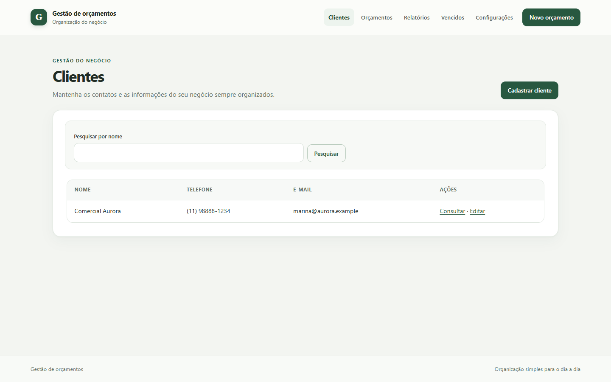
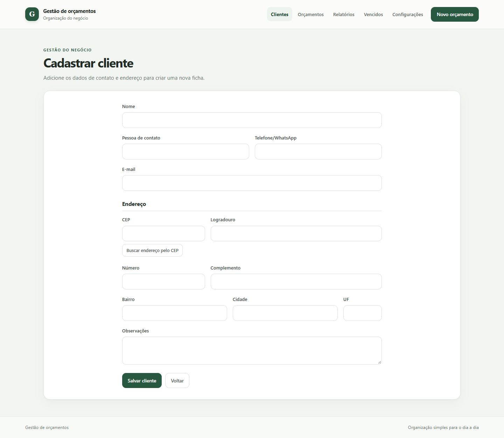
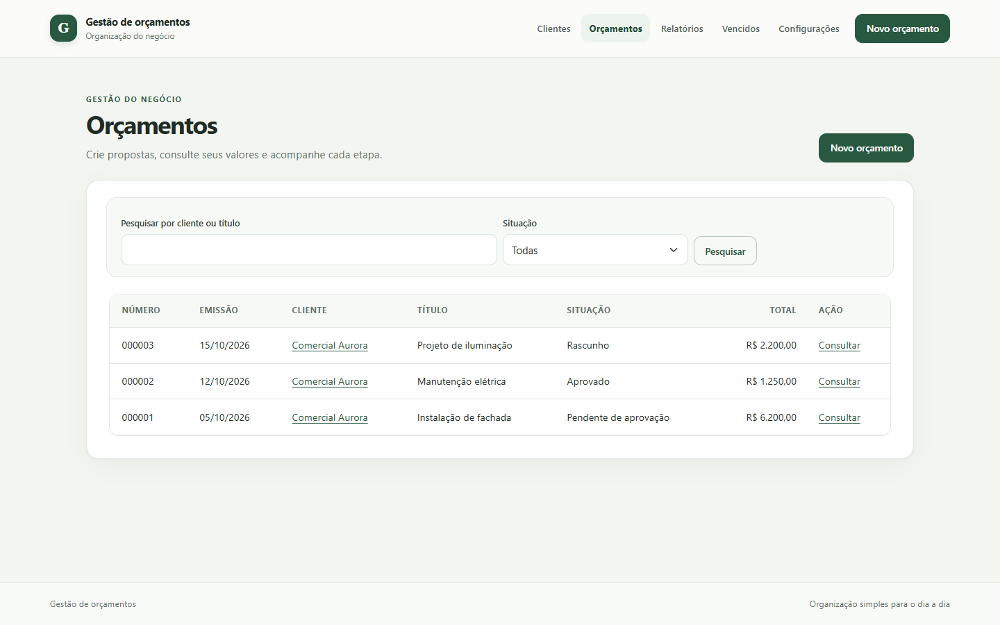
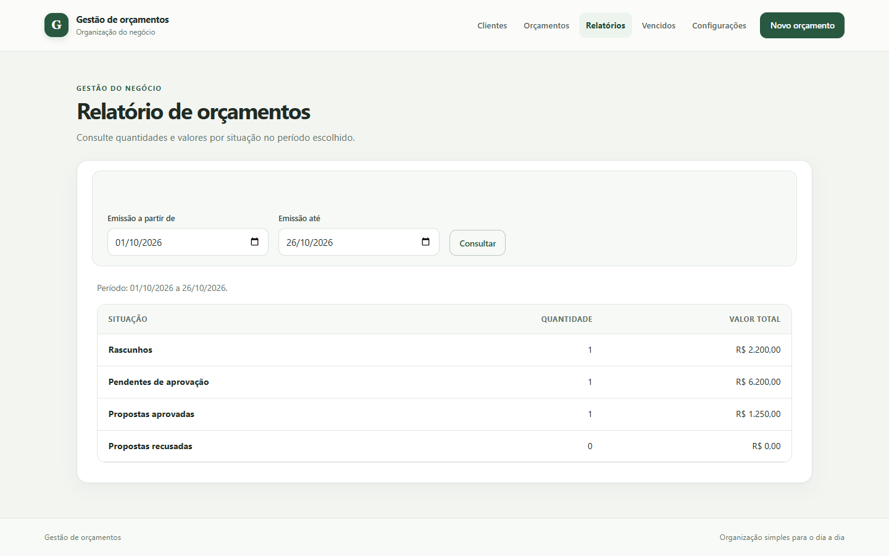
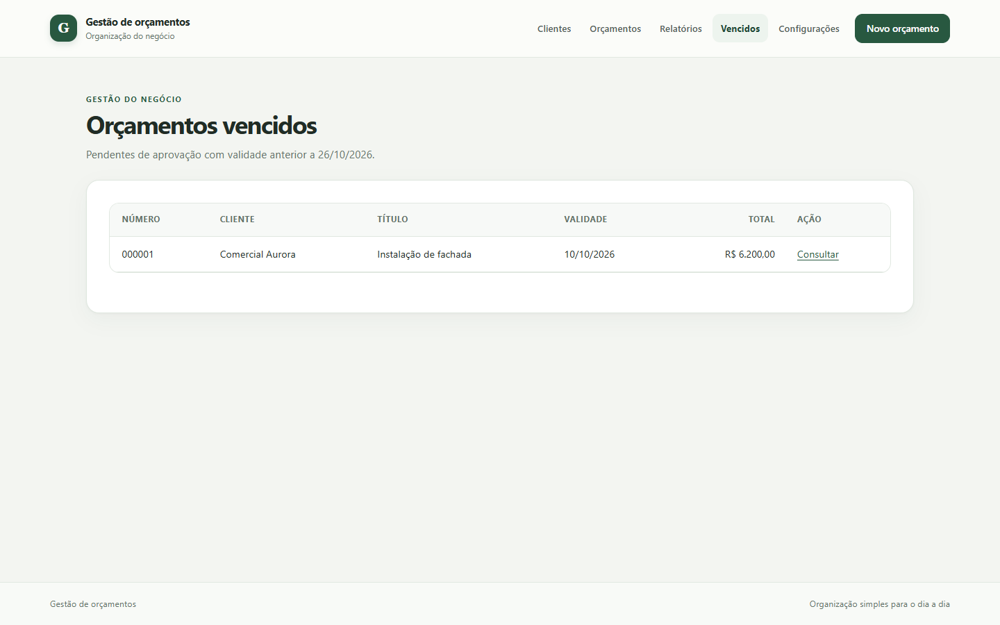
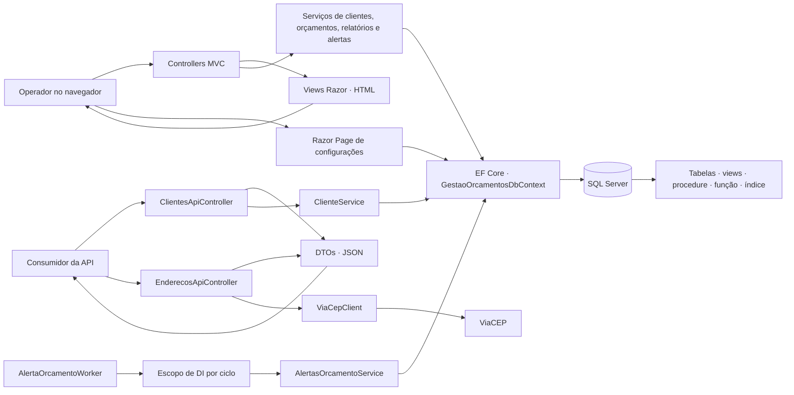

## Sumário

- [Projeto: Gestão de Orçamentos](#projeto-gesto-de-oramentos)
  - [O que é o projeto](#o-que-e-o-projeto)
  - [Problema que resolve](#problema-que-resolve)
  - [Objetivo](#objetivo)
- [Fluxo funcional da aplicação](#fluxo-funcional-da-aplicao)
  - [Imagens da aplicação](#imagens-da-aplicao)
  - [O que a aplicação faz?](#o-que-a-aplicao-faz)
  - [Arquitetura e escolhas técnicas](#arquitetura-e-escolhas-tcnicas)
    - [Padrões e modelos](#padres-e-modelos)
    - [Persistência e processamento](#persistncia-e-processamento)
  - [Fluxo dos orçamentos](#fluxo-dos-oramentos)
  - [API de consulta](#api-de-consulta)
  - [Medição da consulta de vencimentos](#medio-da-consulta-de-vencimentos)
  - [Requisitos e desenvolvimento](#requisitos-e-desenvolvimento)
  - [Publicar no Windows x64](#publicar-no-windows-x64)
  - [Testes](#testes)

---

# Projeto: Gestão de Orçamentos

## O que é o projeto

É um aplicativo web em C# para cadastrar clientes e acompanhar orçamentos. Usa ASP.NET Core 10, Razor, Entity Framework Core e SQL Server; no desenvolvimento, usa SQL Server LocalDB. Também oferece uma API para consulta de clientes e endereços.

## Problema que resolve

Quem prepara propostas precisa acompanhar cliente, itens, valores, validade e resposta. Também precisa consultar os dados enviados mesmo que o cadastro mude depois e localizar propostas pendentes cuja validade passou. O sistema reúne essas informações em cada orçamento, preserva os dados do envio e apresenta os vencidos.

## Objetivo

Centralizar o ciclo do orçamento, do rascunho à aprovação ou recusa, e facilitar o acompanhamento dos vencimentos, dos relatórios e das propostas para impressão. O aplicativo foi concebido para uso pessoal e não inclui login nem controles avançados de segurança.

# Fluxo funcional da aplicação

O operador cria o orçamento, envia a proposta e acompanha sua situação até a aprovação ou recusa. O sistema conserva os dados apresentados no envio, mesmo que os cadastros sejam alterados depois.

## Imagens da aplicação

As imagens mostram o aplicativo em execução com dados fictícios.











[Reproduzir a consulta](docs/performance/medir-indice-vencidos.ps1)

## O que a aplicação faz?

- Cadastra, pesquisa, consulta e edita clientes; impede sua exclusão quando há orçamentos vinculados;
- Mantém os dados do negócio usados nas propostas;
- Cria orçamentos com itens, quantidades, unidades e preços, calcula totais e acompanha as mudanças de situação;
- Apresenta relatórios por período, registra avisos de validade e prepara orçamentos para impressão ou PDF;
- Oferece endpoints HTTP para consulta de clientes e consulta de endereços pelo ViaCEP.

## Arquitetura e escolhas técnicas

É um único aplicativo ASP.NET Core em .NET 10, organizado em camadas dentro do mesmo projeto. A apresentação recebe requisições e monta respostas; serviços coordenam os fluxos da aplicação; o acesso a dados usa Entity Framework Core e SQL Server LocalDB no ambiente de desenvolvimento.

As pastas agrupam responsabilidades que colaboram nesses fluxos:

- `Controllers` tratam requisições MVC e da API;
- `Pages` contém a página Razor Pages de configurações, e `Views` contém as telas Razor dos controllers MVC;
- `Services` implementa operações de clientes, orçamentos, relatórios, alertas e a integração com o ViaCEP;
- `Models` reúne entidades persistidas, modelos de formulário e de tela, e DTOs da API em `Models/Api`;
- `Data` contém o `GestaoOrcamentosDbContext` e as migrations do Entity Framework Core;
- `wwwroot` contém CSS, JavaScript e outros arquivos estáticos da interface.

Os controllers MVC usam serviços e retornam Views Razor. A API retorna JSON, e a página de configurações acessa o `DbContext` diretamente. Um worker em segundo plano chama o serviço de alertas na inicialização e a cada minuto.



### Padrões e modelos

- **MVC e Razor Pages:** controllers tratam requisições e as Views renderizam HTML, já Razor Pages atendem configurações, e os controllers de API retornam JSON.
- **Injeção de dependência:** o contêiner do ASP.NET Core compõe os serviços e define seus ciclos de vida. Os serviços recebem dependências concretas, como `GestaoOrcamentosDbContext`.
- **Unit of Work do Entity Framework Core:** o `DbContext` acompanha alterações e as persiste com `SaveChangesAsync`, e os `DbSet`s dão acesso às entidades.
- **Post/Redirect/Get:** depois de operações de escrita nos formulários MVC, a aplicação redireciona para outra página.
- **Separação de responsabilidades:** controllers cuidam do protocolo HTTP, enquanto serviços concentram fluxos da aplicação. Essa divisão segue o princípio de responsabilidade única no nível dos componentes.
- **Validação e segurança dos formulários:** Data Annotations validam os dados, os serviços repetem a validação antes de gravar e os POSTs MVC usam token antifalsificação.
- **Consultas:** as leituras usam `AsNoTracking`, e operações de banco são assíncronas e recebem o token de cancelamento da requisição.

Os tipos da pasta `Models` têm funções diferentes. Entidades como `Cliente` e `Orcamento` representam dados persistidos e são mapeadas pelo Entity Framework Core. `ClienteFormulario` e `OrcamentoFormulario` recebem e validam dados de entrada, e modelos de tela combinam informações para uma página.

DTO (_Data Transfer Object_) define o formato de dados que atravessa uma fronteira da aplicação. `ClienteDto`, por exemplo, seleciona os campos expostos pela API, enquanto `ClientesPaginaDto` inclui os dados de paginação. Esses DTOs ficam em `Models/Api`, e o cadastro da API reutiliza `ClienteFormulario` como modelo de entrada.

### Persistência e processamento

- `GestaoOrcamentosDbContext` mapeia clientes, configurações, orçamentos e itens. As migrations versionam as alterações do esquema;
- a view SQL `vw_ResumoOrcamentos` calcula os totais para a listagem sem carregar os itens no processo web;
- a procedure `sp_RelatorioOrcamentosPorPeriodo` agrega quantidade e valor por situação;
- a função `fn_OrcamentosVencidos` identifica orçamentos pendentes cuja validade passou. `AlertaOrcamentoWorker` executa o serviço de alertas em segundo plano, com um escopo de DI por ciclo;
- o índice filtrado `IX_Orcamentos_Pendente_Validade` atende à busca dos orçamentos pendentes com validade definida;
- `ViaCepClient` consulta o ViaCEP por meio do cliente HTTP gerenciado pelo ASP.NET Core.

## Fluxo dos orçamentos

- Um orçamento começa como rascunho e pode ser editado ou excluído. O operador pode criá-lo pelo menu ou pela página de um cliente;
- cada subtotal é arredondado para centavos com `decimal` e `AwayFromZero`, e o número apresentado usa o ID do banco com seis dígitos;
- ao enviá-lo para aprovação, a aplicação exige os dados do negócio e registra cópias dos dados do cliente e do negócio;
- enquanto está pendente, o operador pode aprovar, recusar ou devolver o orçamento ao rascunho. A devolução descarta as cópias, e um novo envio registra os dados atualizados;
- orçamentos aprovados ou recusados ficam disponíveis para consulta, sem edição ou exclusão. A consulta usa os dados registrados no envio, mesmo que os cadastros tenham mudado;
- um orçamento pode ser duplicado como novo rascunho. A cópia recebe novo número e data atual, mantém cliente, título, observações e itens, deixa a validade em branco e não copia os dados históricos. Seus itens são independentes do original;
- a impressão apresenta uma versão pronta para impressão ou para salvar em PDF.

O relatório usa a data de emissão e mostra quantidade e valor por situação, inclusive quando uma situação não tem registros no período. A verificação de vencimentos roda na inicialização e a cada minuto, então, registra no máximo um aviso por orçamento que continua pendente e vencido, sem mudar sua situação.

## API de consulta

- `GET /api/clientes?nome=&pagina=1&tamanhoPagina=20`: pesquisa opcional por nome, e a resposta contém `itens`, `pagina`, `tamanhoPagina`, `totalItens` e `totalPaginas`. O tamanho da página aceita valores de 1 a 100;
- `GET /api/clientes/{id}`: retorna um cliente ou `404` quando ele não existe;
- `POST /api/clientes`: cadastra cliente com os mesmos campos e validações da interface e responde `201` com `Location`;
- `GET /api/enderecos/{cep}`: consulta o ViaCEP pelo servidor. O CEP deve conter oito dígitos e a resposta contém os campos de endereço usados no cadastro.

Parâmetros de paginação e dados inválidos retornam `400` com erros por campo. Uma pesquisa sem resultados retorna `itens` vazio. CEP inexistente retorna `404`, e falhas ou timeout do ViaCEP retornam `503`. A consulta de CEP ajuda a preencher o endereço, que também pode ser digitado manualmente.

Em ambiente de desenvolvimento, o documento OpenAPI fica em `/openapi/v1.json`. Para navegar pelos endpoints no Chrome, pode-se usar a [extensão OpenAPI Swaggerizer](https://chromewebstore.google.com/detail/openapi-swaggerizer/lnjdikkckkcpokjbckcgfnmdgikohjhd?authuser=0&hl=pt-BR).

## Medição da consulta de vencimentos

O alerta lista orçamentos pendentes cuja validade é anterior à data de referência. O script abaixo compara a consulta da função `fn_OrcamentosVencidos` com e sem o índice filtrado `IX_Orcamentos_Pendente_Validade`, em um banco LocalDB descartável.

Na medição original, com data de referência fixa em 16/10/2026 e 100.000 orçamentos, os resultados foram:

| Caso                  | Operador             | Linhas lidas | Leituras lógicas | CPU / decorrido |
| --------------------- | -------------------- | -----------: | ---------------: | --------------: |
| Sem o índice          | Clustered Index Scan |      100.000 |            1.044 | 16 ms / 16 ms   |
| Com o índice filtrado | Index Seek           |        2.500 |                7 | < 1 ms / < 1 ms |

Na execução reproduzida em 04/11/2026, a consulta retornou os mesmos 2.500 IDs nos dois casos e repetiu as leituras lógicas. `STATISTICS TIME` registrou:

| Caso                  | Linhas lidas | Leituras lógicas | CPU / decorrido |
| --------------------- | -----------: | ---------------: | --------------: |
| Sem o índice          |      100.000 |            1.044 | 16 ms / 34 ms   |
| Com o índice filtrado |        2.500 |                7 | 0 ms / 3 ms     |

A primeira tabela conserva os tempos da medição original. Cada nova execução imprime seus próprios valores — operador, linhas lidas, leituras lógicas, CPU e tempo decorrido — e atualiza os dois planos reais em `docs/performance/plano-sem-indice.sqlplan` e `docs/performance/plano-com-indice.sqlplan`.

### Reproduzir

Pré-requisitos: Windows com SQL Server LocalDB e instância `MSSQLLocalDB`, SDK .NET 10, `dotnet-ef` 10.x disponível no `PATH` e PowerShell 5.1 ou superior. Para instalar a ferramenta EF Core, se necessário:

```powershell
dotnet tool install --global dotnet-ef
```

Na raiz do repositório, execute:

```powershell
.\docs\performance\medir-indice-vencidos.ps1
```

O script cria um banco com nome aleatório, aplica as migrations, carrega a massa, executa a consulta nos dois casos com `SET STATISTICS IO ON` e plano de execução real, confere os IDs e remove o banco ao terminar. A massa tem 100.000 IDs determinísticos, 5.000 pendentes e 2.500 vencidos em relação a 16/10/2026; também inclui 2.000 validades exatamente nessa data e 500 validades nulas para conferir os limites. Os 2.500 IDs esperados são múltiplos de 40 entre 40 e 100.000.

A saída confirma que os conjuntos e as contagens coincidem, e mostra as métricas de cada caso. CPU e tempo decorrido variam entre execuções e máquinas; os planos reais ficam salvos na pasta `docs/performance`. O SQL executado está em [`consulta-vencidos.sql`](docs/performance/consulta-vencidos.sql), e a carga e as verificações da massa estão em [`medir-indice-vencidos.sql`](docs/performance/medir-indice-vencidos.sql).

O índice reduz leituras ao manter apenas linhas pendentes com validade definida, ordenadas por validade e ID. Essa economia na consulta tem custo de escrita: inserir ou excluir um orçamento que atende ao filtro, mudar sua situação para dentro ou para fora dele, ou alterar sua validade exige inserir, remover ou atualizar uma entrada do índice. O índice também ocupa armazenamento e acrescenta trabalho de I/O às operações que o modificam.

## Requisitos e desenvolvimento

- SDK do .NET 10;
- SQL Server LocalDB.

Confirme que a instância LocalDB está instalada:

```powershell
SqlLocalDB info MSSQLLocalDB
```

A conexão de desenvolvimento está em `src/GestaoOrcamentos.Web/appsettings.Development.json` e usa autenticação integrada do Windows. Para criar ou atualizar o banco, use o Console do Gerenciador de Pacotes do Visual Studio, selecionando `GestaoOrcamentos.Web` como projeto padrão:

```powershell
Update-Database
```

No terminal, com `dotnet-ef` instalado globalmente, execute o comando equivalente:

```powershell
dotnet ef database update --project src/GestaoOrcamentos.Web/GestaoOrcamentos.Web.csproj
```

Na raiz do repositório, restaure e inicie o aplicativo:

```powershell
dotnet restore GestaoOrcamentos.slnx
dotnet run --project src/GestaoOrcamentos.Web/GestaoOrcamentos.Web.csproj
```

Abra `http://127.0.0.1:5198` no navegador. Para compilar sem iniciar o servidor:

```powershell
dotnet build GestaoOrcamentos.slnx
```

## Publicar no Windows x64

O perfil `win-x64-local` publica um executável self-contained de arquivo único em `artifacts/publish/win-x64`. O runtime .NET está incluído, e o SQL Server precisa estar instalado separadamente. Configure a conexão por variável de ambiente:

```powershell
dotnet publish src/GestaoOrcamentos.Web/GestaoOrcamentos.Web.csproj -c Release -p:PublishProfile=win-x64-local

$env:ConnectionStrings__GestaoOrcamentos = 'Server=(localdb)\MSSQLLocalDB;Database=GestaoOrcamentos;Trusted_Connection=True;TrustServerCertificate=True'
Set-Location artifacts/publish/win-x64
.\GestaoOrcamentos.Web.exe --migrate
.\GestaoOrcamentos.Web.exe
```

`--migrate` aplica as migrations e encerra com código 0. Em caso de falha, o erro é registrado e o processo retorna código diferente de zero. A inicialização normal não altera o esquema do banco. O endereço padrão é `http://localhost:5198`, já a porta pode ser alterada por `LocalServer__Port`.

## Testes

Execute a suíte xUnit com:

```powershell
dotnet test GestaoOrcamentos.slnx
```

Os testes cobrem validações, consultas, persistência, cálculos SQL e alertas, e os testes de persistência criam e removem um banco LocalDB próprio.
